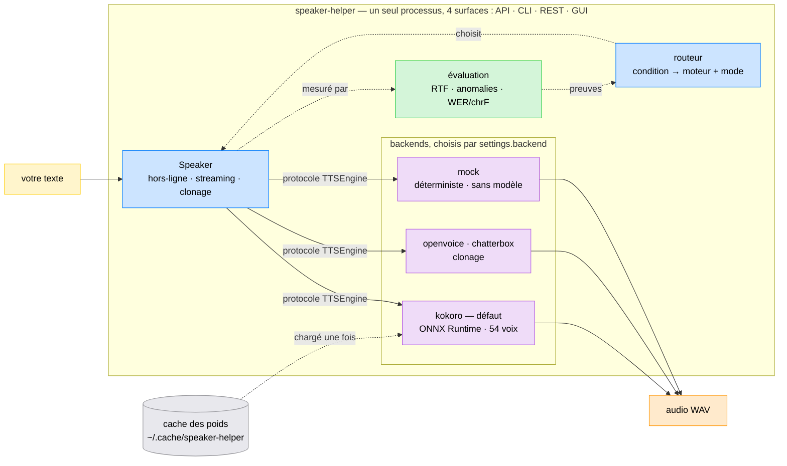

# Speaker Helper

[🇫🇷](LISEZMOI.md) · [🇬🇧](README.md)

[](https://github.com/warith-harchaoui/speaker-helper/actions/workflows/ci.yml) [](LICENSE) [](#)

`Speaker Helper` fait partie d'une collection de bibliothèques appelée `AI Helpers`, développée pour construire de l'Intelligence Artificielle.

[🌍 AI Helpers](https://deraison.ai/ai-helpers)

[](https://deraison.ai/ai-helpers)


**Synthèse vocale professionnelle, hors-ligne et en streaming, avec clonage de
voix et évaluation intégrée, synthétisée *dans votre propre processus* : aucun
serveur à lancer, aucun port à configurer.
[Kokoro](https://huggingface.co/hexgrad/Kokoro-82M) est le moteur par défaut,
avec 54 voix dans neuf langues.**

speaker-helper est le pendant de
[`vocal-helper`](https://github.com/warith-harchaoui) : vocal-helper
transforme la *parole en texte*, speaker-helper transforme le **texte en
parole**. Même cœur, exposé sur **quatre surfaces** : une API
Python typée, une CLI, une API REST et une GUI web minimale. En local
(conda + pip) ou comme serveur Docker.

- **Deux modes.** *Hors-ligne* (tout le texte → un audio) et *streaming*
  (découpage en phrases, faible temps jusqu'au premier son).
- **Aiguillage automatique du moteur.** Donnez votre
  *condition* — **temps réel en ligne** (streaming à délai borné ; la vitesse se
  mesure en facteur temps réel, le moteur doit tourner plus vite que le temps réel) ou **hors-ligne**
  (par lots ; seule la qualité compte). Le routeur choisit le
  meilleur moteur et le meilleur mode à partir de preuves qualité↔vitesse mesurées, avec une
  justification chiffrée. Rien n'est deviné.
- **Temps réel sur CPU.** Le moteur `kokoro` par défaut synthétise plus vite
  que le temps réel (RTF nettement inférieur à 1.0) — sans GPU.
- **Agnostique du moteur et rien à lancer.** Le moteur est un détail
  d'implémentation derrière le protocole `TTSEngine` et chaque backend tourne
  **dans ce processus**. Quatre sont livrés : `kokoro` (le défaut — ONNX
  Runtime, 54 voix), `openvoice` et `chatterbox` (clonage depuis un
  enregistrement) et un `mock` déterministe pour les tests et la CI. Ajouter un
  backend, c'est un seul appel à `register_backend`.
- **Clonage de voix, partout.** Pointez vers un enregistrement, speaker-helper
  clone la voix — dans la bibliothèque, la CLI, l'API REST et la GUI. Les
  transcriptions manquantes sont produites automatiquement avec
  [`vocal-helper`](https://github.com/warith-harchaoui).
- **Évaluation IA intégrée.** Un jeu de données committé, des seuils versionnés
  et des métriques de vitesse, d'anomalie et de fidélité verrouillent la qualité en CI :
  pas de « vibe checks ». La qualité se mesure comme l'**intelligibilité** en
  aller-retour (texte→parole→texte WER/chrF).
- **Aucun téléchargement de modèle pendant la synthèse.** Les poids du moteur
  par défaut sont récupérés une fois, en amont, par
  [`speaker-helper install-voice`](#moteurs-auto-hébergés-sans-hugging-face) :
  depuis une release épinglée, vers un cache local. Rien n'est récupéré pendant
  que vous parlez, si bien qu'une machine en environnement clos n'a besoin que
  de ce cache.
- **Tout inclus.** Bibliothèque, CLI, API REST, GUI web,
  Docker.

Voir [`EXAMPLES.md`](EXAMPLES.md) pour un recueil d'exemples exécutables,
[`docs/tech-report.fr.md`](docs/tech-report.fr.md) pour le rapport technique
([EN](docs/tech-report.en.md)),
et [`README.md`](README.md) pour la version
anglaise.

## Documentation

[💻 Documentation](https://deraison.ai/ai-helpers/docs/speaker-helper-doc/)

[🗺️ Paysage](https://github.com/warith-harchaoui/speaker-helper/blob/main/PAYSAGE.md)

[📋 Exemples](https://github.com/warith-harchaoui/speaker-helper/blob/main/EXAMPLES.md)

## Fonctionnement



speaker-helper ne parle qu'au protocole `TTSEngine`, donc le moteur concret est
interchangeable : `create_engine(settings)` cherche `settings.backend` dans un
registre et renvoie l'objet correspondant. Tout cela tourne **dans votre
processus** — il n'y a pas de moteur ailleurs, pas de port et pas de connexion
qui puisse échouer. Le **routeur** transforme une condition de fonctionnement en
moteur et mode concrets à partir de preuves mesurées ; la couche
d'**évaluation** produit ces preuves.

---

## Installation

**Prérequis** — **Python 3.10–3.13** et **git**, **libsndfile**, **ffmpeg**, multiplateforme. `soundfile` nécessite la bibliothèque native `libsndfile` et `audio-helper` (découpe/concaténation pour le clonage) utilise `ffmpeg` :

- 🍎 **macOS** ([Homebrew](https://brew.sh)) : `brew install python git libsndfile ffmpeg`
- 🐧 **Ubuntu/Debian** : `sudo apt update && sudo apt install -y python3 python3-pip git libsndfile1 ffmpeg`
- 🪟 **Windows** (PowerShell) : `winget install Python.Python.3.12 Git.Git ffmpeg` (`libsndfile` est inclus dans le wheel `soundfile` — rien à installer).

Travaillez dans un environnement Python dédié. Si vous ne savez pas en configurer un, voir [🥸 Tech tips](https://harchaoui.org/warith/4ml/#install).

### Depuis PyPI

```bash
# cœur
pip install speaker-helper
# avec extras (serveur et STT pour clonage/aller-retour d'éval) :
pip install "speaker-helper[server,stt]"
```

L'installation depuis git reste possible pour un commit non publié :

```bash
pip install "git+https://github.com/warith-harchaoui/speaker-helper.git@v0.9.3"
```

Extras disponibles : `server` (API REST), `stt` (vocal-helper), `youtube`,
`podcast`, `mic` (sources speech-to-speech), `eval` (DeepEval), `dev`.

Ou, pour le développement local (conda + pip) :

```bash
conda create -n speaker-helper python=3.11 -y
conda activate speaker-helper
pip install -e ".[server]"          # ajoutez ",dev" pour les outils de test/lint
pip install -e ".[server,stt]"      # ajoutez ",stt" pour auto-transcrire les références de clonage
```

speaker-helper fait partie de l'écosystème **AI Helpers** : il installe
automatiquement [`os-helper`](https://github.com/warith-harchaoui/os-helper)
(journalisation) et
[`audio-helper`](https://github.com/warith-harchaoui/audio-helper)
(découpe et concaténation audio). L'extra optionnel `stt` ajoute
[`vocal-helper`](https://github.com/warith-harchaoui/vocal-helper) pour
transcrire les références de clonage et l'aller-retour d'évaluation.

### La voix par défaut (Kokoro)

Il n'y a aucun moteur à lancer. `kokoro` tourne dans le même processus que votre
code : les deux seules choses dont il a besoin sont un paquet et un fichier.

```bash
pip install "speaker-helper[kokoro]"   # ONNX Runtime + le phonémiseur
speaker-helper install-voice           # ~340 Mo de poids, récupérés une fois
speaker-helper health                  # dit s'il pourrait synthétiser maintenant
```

- **`espeak-ng`** fait la phonémisation. Préférez le paquet système —
  `brew install espeak-ng` sur macOS, `sudo apt install espeak-ng` sur
  Debian/Ubuntu. La copie embarquée dans la roue `espeakng-loader` cherche ses
  données dans le répertoire personnel de la machine qui l'a construite et,
  quand elle ne les trouve pas, appelle `exit(1)` depuis le C : pas de trace,
  rien à rattraper.
- **Les poids** (~340 Mo : un graphe ONNX et une banque de voix) sont tirés une
  fois d'une release épinglée de
  [`kokoro-onnx`](https://github.com/thewh1teagle/kokoro-onnx) vers
  `~/.cache/speaker-helper/kokoro`. `install-voice` vérifie les tailles exactes,
  si bien qu'un téléchargement coupé est réparé au lieu d'être pris pour une
  installation.
- **La vitesse**, mesurée sur cette machine (Apple M2 Max, préchauffée, zéro
  anomalie) : facteur temps réel moyen de **0,22** en français, **0,24** en
  anglais, **0,21** en espagnol — quatre à cinq fois plus vite que le temps
  réel, sur CPU, sans GPU. Voir [`BENCHMARKS.md`](BENCHMARKS.md).

Les backends de clonage s'installent à part, parce que tous deux tirent torch et
que lire une page à voix haute ne devrait pas exiger une pile d'apprentissage
profond : `pip install "speaker-helper[chatterbox]"` (ou `[openvoice]`).

### Moteurs auto-hébergés (sans Hugging Face)

Le moteur par défaut ne touche jamais à Hugging Face. Ses deux fichiers viennent
d'une release GitHub épinglée puis vivent dans un cache local et rien n'est
récupéré pendant la synthèse — si bien que mettre `kokoro` en environnement clos
revient à posséder ce cache, et rien d'autre :

```bash
speaker-helper install-voice            # sur une machine qui a le réseau
# -> ~/.cache/speaker-helper/kokoro/{kokoro-v1.0.onnx,voices-v1.0.bin}
```

Copiez ce répertoire vers la machine fermée (ou montez-le) et `speaker-helper
health` rapporte `status: ok` sans aucun réseau. Un second emplacement,
`~/.cache/sprezzature-skill/kokoro`, est lu lui aussi : une machine qui a déjà
téléchargé les deux mêmes fichiers pour cette suite ne se voit pas redemander
340 Mo.

Les backends de **clonage** sont ceux qui sortent encore : `chatterbox` va
chercher ses propres checkpoints à la première utilisation et `openvoice` réclame
ceux que publie MyShell. `speaker-helper install-voice --engine openvoice` le dit
plutôt que de prétendre le faire à votre place.

---

## Prise en main rapide

### Python

```python
from speaker_helper import Speaker, Settings

spk = Speaker(Settings.from_mapping({"backend": "kokoro", "language": "fr"}))
result = spk.save("Bonjour le monde.", "hello.wav")
print(f"{result.duration_s:.2f}s d'audio, RTF {result.rtf:.2f}")
# 1.19s d'audio, RTF 4.42    <- premier appel : la session ONNX se construit ici
# 1.19s d'audio, RTF 0.31    <- tous les appels suivants
```

La première synthèse charge le modèle : son facteur temps réel mesure donc le
*chargement*, pas le moteur. `Speaker.warmup()` déplace ce coût là où vous le
voulez — c'est pour cela que la passerelle d'évaluation préchauffe avant de
chronométrer quoi que ce soit.

### CLI

`speaker-helper` est un seul groupe
[click](https://click.palletsprojects.com) et répond aussi bien à `-h` qu'à
`-V`. Les options globales sont portées par le groupe : elles précèdent donc
la sous-commande — `speaker-helper --backend mock synth …`,
`speaker-helper --engine kokoro voices`.

```bash
speaker-helper --engine kokoro voices
speaker-helper synth "Bonjour le monde." -o hello.wav
speaker-helper synth "Une. Deux. Trois." -o out.wav --stream
speaker-helper --language fr route --condition online_realtime    # choisit un moteur
speaker-helper --backend mock eval               # verrouille la qualité (sans moteur)
speaker-helper --clone synth "Bonjour." -o cloned.wav
```

### Serveur API REST

```bash
speaker-helper serve --bind-host 0.0.0.0 --bind-port 8080
curl -s -X POST localhost:8080/synth -H 'content-type: application/json' \
     -d '{"text": "Bonjour."}' -o out.wav
# streaming (Server-Sent Events, un chunk JSON par phrase) :
curl -N -X POST localhost:8080/synth/stream -H 'content-type: application/json' \
     -d '{"text": "Une. Deux. Trois."}'
```

Le serveur, en plus :

- sert une **GUI web minimale** à `/` (une page vanilla-JS + Tailwind sans
  dépendance pour la synthèse, le streaming, les voix, le clonage et le
  routeur) : ouvrez `http://localhost:8080/` ;
- expose `POST /route` (le routeur de moteurs) aux côtés de `/synth`,
  `/synth/stream`, `/voices` et `/clone`.

Ou avec Docker — le moteur tourne **dans** le conteneur, il n'y a donc rien à
trouver sur l'hôte :

```bash
docker compose up --build            # API speaker-helper sur :8080
```

---

## Choisir un moteur (le routeur)

La couche d'évaluation *mesure* la qualité et la vitesse ; le **routeur** agit
sur ces preuves. Vous énoncez une **condition** de fonctionnement et il renvoie
un moteur et un mode concrets, justifiés par les chiffres, jamais devinés.

- **`online_realtime`** — streaming à délai borné. La vitesse se mesure en **facteur
  temps réel (RTF)** : le moteur doit synthétiser *plus vite que le temps réel*
  (`RTF < 1`), avec une marge pour le temps jusqu'au premier son et la gigue
  (plafond `0.8`). Parmi les moteurs qui tiennent le rythme, le routeur
  **maximise la qualité** sur le front de Pareto qualité↔RTF et sélectionne le
  streaming avec des réglages à faible TTFA.
- **`offline`** — par lots. Aucune contrainte temps réel, donc **seule la
  qualité compte** : le moteur de plus haute qualité l'emporte, la
  vitesse est ignorée.

La qualité se mesure comme l'**intelligibilité** en aller-retour
(texte→parole→texte WER/chrF via `vocal-helper`) ou, tant qu'un moteur n'est pas
mesuré, comme un prior hérité. Chaque décision indique lequel (`quality_source`) et porte un
flag de `confidence`.

```python
from speaker_helper import route, RouteRequest, Speaker

decision = route(RouteRequest(condition="online_realtime", language="fr"))
print(decision.engine, decision.mode, decision.confidence)
print(decision.justification)

# ou construisez un Speaker directement depuis un point de fonctionnement routé :
spk = Speaker.from_route("offline", language="fr")
```

```bash
speaker-helper --language fr route --condition online_realtime
speaker-helper route --condition offline --json decision.json
```

Les nouveaux moteurs sont caractérisés dans l'*étude* compagne (RTF, MOS et
similarité de locuteur mesurés) et réinjectés ici comme données : la boîte à
outils aiguille, l'étude mesure.

---

## Clonage de voix

Pointez vers un enregistrement, speaker-helper clone la voix — dans la
bibliothèque, la CLI et l'API REST. Si vous ne fournissez pas de transcription
de la référence, elle est produite automatiquement avec
[`vocal-helper`](https://github.com/warith-harchaoui) (installez l'extra `stt`).
Une référence prête à l'emploi — une voix féminine française issue du jeu de
données CML-TTS (CC BY 4.0, voir `assets/ref-fr-female.NOTICE.md`) — est fournie
sous `assets/ref-fr-female.wav` et sert de défaut.

```python
from speaker_helper import Speaker, Settings, VoiceSample

# C'est `backend` qui choisit le moteur ; `engine` n'est qu'une étiquette.
spk = Speaker(Settings.from_mapping({"backend": "chatterbox"}))
# ne donnez que l'audio — la transcription est produite et alignée pour vous :
await spk.clone_voice("ma-voix", [VoiceSample("ma_voix.wav", "")])
result = await spk.say("Maintenant je parle avec la voix clonée.")
```

```bash
speaker-helper clone                        # clone la référence fournie, affiche l'id
speaker-helper --clone-audio ma_voix.wav synth "Bonjour." -o out.wav
```

Un audio de référence plus long que la limite des moteurs de clonage (30 s est
le plafond courant, speaker-helper tronque donc à 28 s) est coupé
automatiquement (via
[`audio-helper`](https://github.com/warith-harchaoui/audio-helper)) puis
re-transcrit, pour que l'audio et le texte restent alignés. `kokoro` ne clone
pas du tout et le dit en nommant les deux backends qui le font, plutôt que de
lever un `NotImplementedError` nu.

---

## Speech-to-speech (re-voicing)

Importez de l'audio depuis les paquets sources de l'écosystème AI Helpers et
re-voicez-le : transcrit avec
[`vocal-helper`](https://github.com/warith-harchaoui) puis re-synthétisé,
au besoin dans une voix clonée ou une autre langue :

```python
import asyncio
from speaker_helper import Speaker, Settings
from speaker_helper.sources import from_youtube, revoice

async def main() -> None:
    src = from_youtube("https://youtu.be/…")                 # extra : youtube
    async with Speaker(Settings.from_mapping({"language": "fr"})) as spk:
        out = await revoice(src, spk)                        # transcrit + re-parle
    open("revoiced.wav", "wb").write(out.wav_bytes)

asyncio.run(main())
```

```bash
speaker-helper speak-from --source youtube --url https://youtu.be/… -o out.wav
speaker-helper speak-from --source podcast --url https://feed/rss   -o out.wav
speaker-helper --clone speak-from --source mic --seconds 5          -o out.wav
```

Les sources sont des extras optionnels : `youtube` (`youtube-helper`), `podcast`
(`podcast-helper`), `mic` (`capture-helper`).

---

## Évaluation (pas de « vibe checks »)

La qualité est verrouillée, pas devinée. `speaker-helper eval` exécute le moteur
sur un jeu de données committé et vérifie des seuils versionnés : **synthèse plus
rapide que le temps réel**, **zéro anomalie audio** (vide, saturé, durée
aberrante) et, avec un transcripteur branché, un **aller-retour** WER/chrF. Il
sort avec un code non nul quand la barre n'est pas atteinte, ce qui verrouille la
CI.

```bash
speaker-helper --backend mock eval                 # déterministe, sans modèle
# backend=mock engine=kokoro cases=12
# mean_rtf=0.3 p95_rtf=0.3 anomaly_rate=0.0 quality=1.0 (prior)
# PASS

speaker-helper eval --languages fr,en,es --json report.json    # le vrai moteur
# lang   cases  mean_rtf  p95_rtf  anomaly  quality  verdict
# fr        12     0.223    0.261    0.000    0.750  PASS
# en        10     0.237    0.299    0.000    0.750  PASS
# es        10     0.206    0.230    0.000    0.750  PASS
```

`--languages` préchauffe le moteur langue par langue avant de chronométrer,
c'est-à-dire ce qu'on attend d'un banc d'essai. Un `eval` mono-langue ne le fait
pas : sur un processus froid, son premier cas porte le chargement du modèle et
son p95 rapporte cela plutôt que le moteur.

L'évaluation cible le `Speaker` agnostique du moteur, donc la même passerelle
évalue le backend `mock` en CI ou un vrai moteur en local ; seul `--backend`
change.

Pour les équipes qui standardisent sur un framework, l'extra `eval` ajoute un
pont [DeepEval](https://github.com/confident-ai/deepeval)
(`RealTimeFactorMetric`, `AudioIntegrityMetric` et `RoundTripIdempotenceMetric`,
le contrôle chrF texte→parole→texte) qui rapporte les mêmes mesures comme
métriques DeepEval, de façon déterministe et hors-ligne.

---

## Configuration

Copiez [`settings.yaml.example`](settings.yaml.example) vers `settings.yaml`
(ignoré par git) ou utilisez
[`speaker_config.json.example`](speaker_config.json.example) comme référence.
Chaque clé peut être surchargée par une variable d'environnement
`SPEAKER_HELPER_*` ; les références `${VAR}` dans le YAML sont remplacées depuis
l'environnement au chargement.

---

## Développement

```bash
pip install -e ".[dev,server]"
pytest -q -m "not slow"       # suite rapide et déterministe (sans moteur)
pytest -q --cov=speaker_helper --cov-report=term-missing   # avec couverture
pytest -m slow                # le banc d'essai facteur temps réel ; machine au repos
ruff check speaker_helper tests && ruff format --check speaker_helper tests
speaker-helper --backend mock eval    # exécute la passerelle d'évaluation en local
```

La CI exécute ruff (lint + format) et la suite rapide avec couverture verrouillée
(`--cov-fail-under=70`) sur Python 3.10–3.13 ; un test qui échoue bloque les
fusions. La suite rapide pilote le backend `mock` déterministe : elle ne nécessite
aucun moteur.

---

## Auteur

- [Warith HARCHAOUI](https://linkedin.com/in/warith-harchaoui)

## Remerciements

Merci aux contributrices, contributeurs, relectrices,
relecteurs et utilisateurs qui ont aidé à améliorer ce projet, ainsi qu'aux
auteurs des pièces dont la voix par défaut est faite :
[Kokoro](https://huggingface.co/hexgrad/Kokoro-82M) (hexgrad) pour le modèle,
[`kokoro-onnx`](https://github.com/thewh1teagle/kokoro-onnx) pour l'export ONNX
et les poids publiés et
[espeak-ng](https://github.com/espeak-ng/espeak-ng) pour la phonémisation.

## Licence

BSD-3-Clause © Warith HARCHAOUI.
