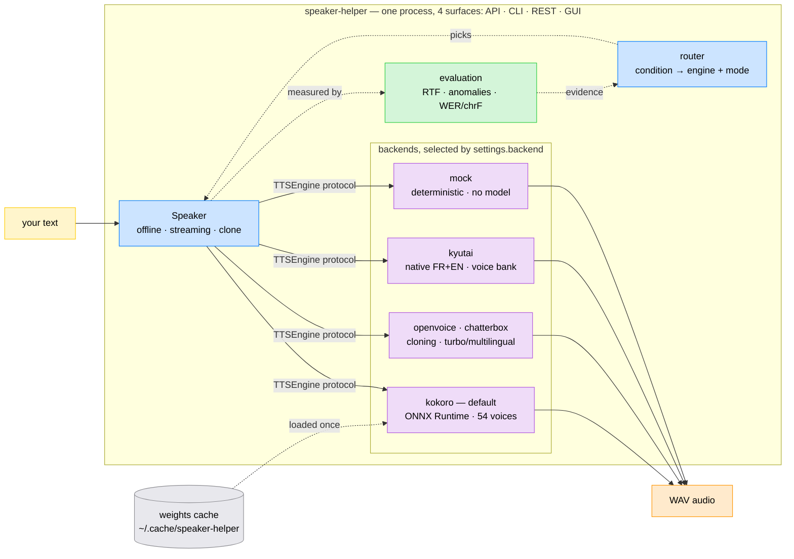

# Speaker Helper

[🇫🇷](https://github.com/warith-harchaoui/speaker-helper/blob/main/LISEZMOI.md) · [🇬🇧](https://github.com/warith-harchaoui/speaker-helper/blob/main/README.md)

[](https://github.com/warith-harchaoui/speaker-helper/actions/workflows/ci.yml) [](https://github.com/warith-harchaoui/speaker-helper/blob/main/LICENSE) [](#)

`Speaker Helper` belongs to a collection of libraries called `AI Helpers` developed for building Artificial Intelligence.

[🌍 AI Helpers](https://deraison.ai/ai-helpers)

[](https://deraison.ai/ai-helpers)


**Professional text-to-speech — offline and streaming, with voice cloning and a
built-in evaluation gate — synthesised *in your own process*: no server to
start, no port to configure. [Kokoro](https://huggingface.co/hexgrad/Kokoro-82M)
is the default engine, with 54 voices across nine languages.**

speaker-helper is the counterpart of
[`vocal-helper`](https://github.com/warith-harchaoui): where vocal-helper turns
*speech into text*, speaker-helper turns **text into speech**. It gives you the
same core over **four surfaces** — a typed Python API, a CLI, a REST API, and a
minimal web GUI — runnable locally (conda + pip) or as a Docker server.

- **Two modes.** *Offline* (whole text → one audio) and *streaming*
  (sentence-split, low time-to-first-audio).
- **Automatic engine routing.** Tell speaker-helper your *condition* —
  **online real-time** (delay-bounded streaming; speed = real-time factor, must
  run faster than real time) or **offline** (batch; quality is the only
  objective) — and the router picks the best engine + mode from measured
  quality↔speed evidence, with a number-citing justification. No guessing.
- **The operating matrix decides the engine, not a hard-coded default.**
  `backend: auto` (the default) resolves from the mode: **offline goes to
  `chatterbox`** in every language — its Turbo model for English, its
  23-language Multilingual model elsewhere — and **streaming goes to
  `kokoro`**, which synthesises faster than real time on CPU (RTF well below
  1.0, no GPU). Name a backend explicitly and it is honoured as-is.
- **Backend-agnostic, and nothing to launch.** The engine is an implementation
  detail behind a `TTSEngine` protocol, and every backend runs **in this
  process**. Five ship: `kokoro` (ONNX Runtime, 54 voices — the streaming
  default),
  `openvoice` and `chatterbox` (cloning from a recording; the chatterbox
  backend auto-picks its Turbo model for English and its 23-language
  Multilingual model elsewhere), `kyutai` (native French and English from
  Kyutai's 1.6B model, voices from a published embedding bank), and a
  deterministic `mock` for tests and CI. A new backend is one
  `register_backend` call.
- **Voice cloning, everywhere.** Point at a recording and speaker-helper clones
  the voice — in the library, CLI, REST API, and GUI. Missing transcripts are
  derived automatically with [`vocal-helper`](https://github.com/warith-harchaoui).
- **A pronunciation lexicon, applied by default.** State once, in a
  `lexicon.yaml`, how a word is pronounced — exact IPA (spliced verbatim into
  kokoro's phoneme stream, deterministic) or an orthographic respelling (for
  engines without phoneme access). An entry with neither gets its respelling
  derived **once** by a local LLM (resolved through `best-engine-ai-helper`,
  served by Ollama) and cached; after that, everything is deterministic and
  offline. See [`lexicon.yaml.example`](https://github.com/warith-harchaoui/speaker-helper/blob/main/lexicon.yaml.example).
- **Long texts don't degrade.** Past ~500 characters, `say()` synthesises
  sentence-group chunks and concatenates them; the local LLM places the cuts
  at discourse boundaries (it only ever *groups* locally-split sentences, so
  the text cannot change), with a deterministic greedy fallback.
- **Built-in AI evaluation.** A committed dataset, versioned thresholds, and
  speed/anomaly/fidelity metrics gate quality in CI — no vibe checks. Quality is
  measured as round-trip **intelligibility** (text→speech→text WER/chrF).
- **No model download at synthesis time.** The default engine's weights are
  fetched once, ahead of use, by
  [`speaker-helper install-voice`](#self-hosted-engines-no-hugging-face) — from
  a pinned release, into a local cache. Nothing is fetched while you are
  speaking, so an air-gapped box only needs that cache.
- **Batteries included.** Library, CLI, REST API, web GUI,
  Docker.

See [`EXAMPLES.md`](https://github.com/warith-harchaoui/speaker-helper/blob/main/EXAMPLES.md) for a runnable cookbook,
[`docs/tech-report.en.md`](https://github.com/warith-harchaoui/speaker-helper/blob/main/docs/tech-report.en.md) for the technical report
([FR](https://github.com/warith-harchaoui/speaker-helper/blob/main/docs/tech-report.fr.md)),
and [`LISEZMOI.md`](https://github.com/warith-harchaoui/speaker-helper/blob/main/LISEZMOI.md) for the French
readme.

## Documentation

[💻 Documentation](https://deraison.ai/ai-helpers/docs/speaker-helper-doc/)

[🗺️ Landscape](https://github.com/warith-harchaoui/speaker-helper/blob/main/LANDSCAPE.md)

[📋 Examples](https://github.com/warith-harchaoui/speaker-helper/blob/main/EXAMPLES.md)

## How it fits together



speaker-helper talks only to the `TTSEngine` protocol, so the concrete engine is
swappable: `create_engine(settings)` looks `settings.backend` up in a registry
and returns the matching object. All of it runs **inside your process** — there
is no engine elsewhere, no port, and no connection to fail. The **router** turns
an operating condition into a concrete engine + mode from measured evidence; the
**evaluation** layer produces that evidence.

---

## How it works


## Installation

**Prerequisites** — **Python 3.10–3.13** and **git**, **libsndfile**, **ffmpeg**, cross-platform. `soundfile` needs the native `libsndfile` library, and `audio-helper` (voice-clone trimming / concatenation) uses `ffmpeg`:

- 🍎 **macOS** ([Homebrew](https://brew.sh)): `brew install python git libsndfile ffmpeg`
- 🐧 **Ubuntu/Debian**: `sudo apt update && sudo apt install -y python3 python3-pip git libsndfile1 ffmpeg`
- 🪟 **Windows** (PowerShell): `winget install Python.Python.3.12 Git.Git ffmpeg` (`libsndfile` is bundled with the `soundfile` wheel — no separate install).

We recommend using Python environments. Check this link if you're unfamiliar with setting one up: [🥸 Tech tips](https://harchaoui.org/warith/4ml/#install).

### From PyPI

```bash
# core
pip install speaker-helper
# with extras (server, and STT for cloning/eval round-trip):
pip install "speaker-helper[server,stt]"
```

Installing from git still works if you need an unreleased commit:

```bash
pip install "git+https://github.com/warith-harchaoui/speaker-helper.git@v0.9.3"
```

Available extras: `server` (REST API), `stt` (vocal-helper), `youtube`,
`podcast`, `mic` (speech-to-speech sources), `eval` (DeepEval), `dev`.

Or, for local development (conda + pip):

```bash
conda create -n speaker-helper python=3.11 -y
conda activate speaker-helper
pip install -e ".[server]"          # add ",dev" for the test/lint toolchain
pip install -e ".[server,stt]"      # add ",stt" to auto-transcribe clone references
```

speaker-helper is part of the **AI Helpers** ecosystem: it installs
[`os-helper`](https://github.com/warith-harchaoui/os-helper) (logging) and
[`audio-helper`](https://github.com/warith-harchaoui/audio-helper) (audio
slicing/concatenation) automatically. The optional `stt` extra adds
[`vocal-helper`](https://github.com/warith-harchaoui/vocal-helper) for
transcribing voice-clone references and the evaluation round-trip.

### The default voice (Kokoro)

There is no engine to start. `kokoro` runs in the same process as your code, so
the two things it needs are a package and a file:

```bash
pip install "speaker-helper[kokoro]"   # ONNX Runtime + the phonemiser
speaker-helper install-voice           # ~340 MB of weights, fetched once
speaker-helper health                  # says whether it could synthesise now
```

- **`espeak-ng`** does the phonemisation. Prefer the system package —
  `brew install espeak-ng` on macOS, `sudo apt install espeak-ng` on
  Debian/Ubuntu. The copy bundled in the `espeakng-loader` wheel looks for its
  data in the home directory of the machine that built it and, when it does not
  find it, calls `exit(1)` from C: no traceback, no catching it.
- **The weights** (~340 MB: an ONNX graph and a voice bank) are pulled once from
  a pinned [`kokoro-onnx`](https://github.com/thewh1teagle/kokoro-onnx) release
  into `~/.cache/speaker-helper/kokoro`. `install-voice` checks the exact sizes,
  so a truncated download is repaired instead of being mistaken for an install.
- **Speed**, measured on this machine (Apple M2 Max, warmed, zero anomalies):
  mean real-time factor **0.22** in French, **0.24** in English, **0.21** in
  Spanish — four to five times faster than real time on the CPU, no GPU
  involved. See
  [`BENCHMARKS.md`](https://github.com/warith-harchaoui/speaker-helper/blob/main/BENCHMARKS.md).

The cloning backends are separate installs, because both pull torch and reading
a page aloud should not require a deep-learning stack:
`pip install "speaker-helper[chatterbox]"` (or `[openvoice]`).

### Self-hosted engines (no Hugging Face)

The default engine never touches Hugging Face. Its two files come from a pinned
GitHub release and then live in a local cache, and nothing is fetched while
synthesis is running — so air-gapping `kokoro` means having that cache, and
nothing else:

```bash
speaker-helper install-voice            # on a machine with a network
# -> ~/.cache/speaker-helper/kokoro/{kokoro-v1.0.onnx,voices-v1.0.bin}
```

Copy that directory to the closed machine (or mount it) and `speaker-helper
health` reports `status: ok` with no network at all. A second location,
`~/.cache/sprezzature-skill/kokoro`, is read as well, so a machine that already
downloaded the same two files for that suite is not asked for 340 MB twice.

The **cloning** backends are the ones that still reach out: `chatterbox` fetches
its own checkpoints on first use, and `openvoice` wants the checkpoints MyShell
publishes. `speaker-helper install-voice --engine openvoice` says so rather than
pretending it can do it for you.

---

## Quick start

### Python

```python
from speaker_helper import Speaker, Settings

spk = Speaker(Settings.from_mapping({"backend": "kokoro", "language": "fr"}))
result = spk.save("Bonjour le monde.", "hello.wav")
print(f"{result.duration_s:.2f}s audio, RTF {result.rtf:.2f}")
# 1.19s audio, RTF 4.42      <- first call: the ONNX session is built here
# 1.19s audio, RTF 0.31      <- every call after it
```

The first synthesis loads the model, so its real-time factor measures the
*load*, not the engine. `Speaker.warmup()` moves that cost to where you want it
— which is why the evaluation gate warms up before it times anything.

### CLI

`speaker-helper` is one [click](https://click.palletsprojects.com) group, and
`-h` / `-V` both answer. Global options are declared on the group, so they
precede the sub-command: `speaker-helper --backend mock synth …`,
`speaker-helper --engine kokoro voices`.

```bash
speaker-helper --engine kokoro voices
speaker-helper synth "Bonjour le monde." -o hello.wav
speaker-helper synth "Une. Deux. Trois." -o out.wav --stream
speaker-helper --language fr route --condition online_realtime    # pick an engine
speaker-helper --backend mock eval               # gate quality (no engine needed)
speaker-helper --clone synth "Bonjour." -o cloned.wav
```

### REST API server

```bash
speaker-helper serve --bind-host 0.0.0.0 --bind-port 8080
curl -s -X POST localhost:8080/synth -H 'content-type: application/json' \
     -d '{"text": "Bonjour."}' -o out.wav
# streaming (Server-Sent Events, one JSON chunk per sentence):
curl -N -X POST localhost:8080/synth/stream -H 'content-type: application/json' \
     -d '{"text": "Une. Deux. Trois."}'
```

The server also:

- serves a **minimal web GUI** at `/` (a dependency-free vanilla-JS + Tailwind
  page for synth, streaming, voices, cloning, and the router) — just open
  `http://localhost:8080/`;
- exposes `POST /route` (the engine router) alongside `/synth`, `/synth/stream`,
  `/voices`, and `/clone`.

Or with Docker — the engine runs **inside** the container, so there is nothing
on the host for it to find:

```bash
docker compose up --build            # speaker-helper API on :8080
```

---

## Choosing an engine (the router)

The evaluation layer *measures* quality and speed; the **router** acts on that
evidence. You state an operating **condition** and it returns a concrete engine
+ mode, justified by the numbers — never a guess.

- **`online_realtime`** — delay-bounded streaming. Speed is the **real-time
  factor (RTF)**: the engine must synthesise *faster than real time* (`RTF < 1`),
  with a margin for time-to-first-audio and jitter (ceiling `0.8`). Among the
  engines that keep up, the router **maximises quality** on the quality↔RTF
  Pareto front, and selects streaming with low-TTFA knobs.
- **`offline`** — batch. There is no real-time constraint, so **quality is the
  only objective**: the highest-quality engine wins, speed disregarded.

The two conditions rank quality on **different criteria**, and every decision
reports which one it used (`quality_source`, `rtf_source`) — provenance, not
a derived grade.
`online_realtime` reads the public arena Elo (`public_elo` — human pairwise
votes; an engine listed on no public arena scores `0.0` with `no_public_elo`
rather than inheriting a flattering prior). `offline` reads the owner-ratified
per-language priors (`prior`), or a measurement where one exists — kokoro's
UTMOSv2 score (`measured_mos`), or the round-trip chrF of your own evaluation
reports (`measured_chrf`) when you pass them in.

```python
from speaker_helper import route, RouteRequest, Speaker

decision = route(RouteRequest(condition="online_realtime", language="fr"))
print(decision.engine, decision.mode, decision.quality_source)
print(decision.justification)

# or build a Speaker straight from a routed operating point:
spk = Speaker.from_route("offline", language="fr")
```

```bash
speaker-helper --language fr route --condition online_realtime
speaker-helper route --condition offline --json decision.json
```

New engines are characterised in the companion *study* (measured RTF / MOS /
speaker-similarity) and folded back here as data — the toolbox routes, the study
measures.

---

## Voice cloning

Point at a recording and speaker-helper clones the voice — in the library, CLI,
and REST API. If you do not supply a transcript of the reference, it is derived
automatically with [`vocal-helper`](https://github.com/warith-harchaoui) (install
the `stt` extra). A ready-to-use reference — a French female voice from the
CML-TTS dataset (CC BY 4.0, see `assets/ref-fr-female.NOTICE.md`) — ships as
`assets/ref-fr-female.wav` and is the default.

```python
from speaker_helper import Speaker, Settings, VoiceSample

# `backend` is what selects the engine; `engine` is only a label on results.
spk = Speaker(Settings.from_mapping({"backend": "chatterbox"}))
# give only the audio — the transcript is transcribed and aligned for you:
await spk.clone_voice("my-voice", [VoiceSample("my_voice.wav", "")])
result = await spk.say("Maintenant je parle avec la voix clonée.")
```

```bash
speaker-helper clone                       # clone the bundled reference, print id
speaker-helper --clone-audio my_voice.wav synth "Bonjour." -o out.wav
```

Reference audio longer than the cloning engines' limit (30 s is the common
ceiling, so speaker-helper trims to 28 s) is cut automatically (via
[`audio-helper`](https://github.com/warith-harchaoui)) and re-transcribed, so
audio and text stay aligned. `kokoro` does not clone at all and says so, naming
the two backends that do, rather than raising a bare `NotImplementedError`.

---

## Speech-to-speech (re-voicing)

Bring audio in from the AI Helpers source packages and re-voice it — transcribed
with [`vocal-helper`](https://github.com/warith-harchaoui) and spoken back
(optionally in a cloned voice or another language):

```python
import asyncio
from speaker_helper import Speaker, Settings
from speaker_helper.sources import from_youtube, revoice

async def main() -> None:
    src = from_youtube("https://youtu.be/…")                 # extra: youtube
    async with Speaker(Settings.from_mapping({"language": "fr"})) as spk:
        out = await revoice(src, spk)                        # transcribe + re-speak
    open("revoiced.wav", "wb").write(out.wav_bytes)

asyncio.run(main())
```

```bash
speaker-helper speak-from --source youtube --url https://youtu.be/… -o out.wav
speaker-helper speak-from --source podcast --url https://feed/rss   -o out.wav
speaker-helper --clone speak-from --source mic --seconds 5          -o out.wav
```

Sources are optional extras: `youtube` (`youtube-helper`), `podcast`
(`podcast-helper`), `mic` (`capture-helper`).

---

## Evaluation (no vibe checks)

Quality is gated, not guessed. `speaker-helper eval` runs the engine over a
committed dataset and checks versioned thresholds — **synthesis faster than real
time**, **zero audio anomalies** (empty / clipped / aberrant duration), and,
with an STT transcriber wired in, a WER/chrF **round-trip**. It exits non-zero
when the bar is missed, so it gates CI.

```bash
speaker-helper --backend mock eval                 # deterministic, no model
# backend=mock engine=kokoro cases=12
# mean_rtf=0.3 p95_rtf=0.3 anomaly_rate=0.0 quality=1.0 (prior)
# PASS

speaker-helper eval --languages fr,en,es --json report.json    # the real engine
# lang   cases  mean_rtf  p95_rtf  anomaly  quality  verdict
# fr        12     0.223    0.261    0.000    0.750  PASS
# en        10     0.237    0.299    0.000    0.750  PASS
# es        10     0.206    0.230    0.000    0.750  PASS
```

`--languages` warms the engine up per language before timing, which is what you
want from a benchmark. A single-language `eval` does not, so on a cold process
its first case carries the model load and its p95 reports that instead of the
engine.

The evaluation targets the engine-agnostic `Speaker`, so the same gate grades
the `mock` backend in CI or a real engine locally — only `--backend` differs.

For teams standardising on a framework, the `eval` extra adds a
[DeepEval](https://github.com/confident-ai/deepeval) binding
(`RealTimeFactorMetric`, `AudioIntegrityMetric`, and `RoundTripIdempotenceMetric`
— the text→speech→text chrF check) that reports the same measurements as DeepEval
custom metrics — deterministic and offline.

---

## Configuration

Copy [`settings.yaml.example`](https://github.com/warith-harchaoui/speaker-helper/blob/main/settings.yaml.example) to `settings.yaml` (it is
gitignored) or use [`speaker_config.json.example`](https://github.com/warith-harchaoui/speaker-helper/blob/main/speaker_config.json.example)
as a reference. Every key can be overridden by a `SPEAKER_HELPER_*` environment
variable; `${VAR}` references inside the YAML are expanded from the environment.

---

## Development

```bash
pip install -e ".[dev,server]"
pytest -q -m "not slow"       # fast, deterministic suite (no engine needed)
pytest -q --cov=speaker_helper --cov-report=term-missing   # with coverage
pytest -m slow                # the real-time-factor benchmark; quiet machine only
ruff check speaker_helper tests && ruff format --check speaker_helper tests
speaker-helper --backend mock eval    # run the evaluation gate locally
```

CI runs ruff (lint + format) and the coverage-gated fast suite (`--cov-fail-under=70`)
on Python 3.10–3.13; a failing check blocks merges. The fast suite drives the
deterministic `mock` backend, so it needs no engine.

---

## Author

- [Warith HARCHAOUI](https://linkedin.com/in/warith-harchaoui)

## Acknowledgements

Special thanks to the contributors, reviewers, and users who helped improve
this project — and to the authors of the pieces the default voice is made of:
[Kokoro](https://huggingface.co/hexgrad/Kokoro-82M) (hexgrad) for the model,
[`kokoro-onnx`](https://github.com/thewh1teagle/kokoro-onnx) for the ONNX
export and the published weights, and
[espeak-ng](https://github.com/espeak-ng/espeak-ng) for the phonemisation.

## License

BSD-3-Clause © Warith HARCHAOUI.
