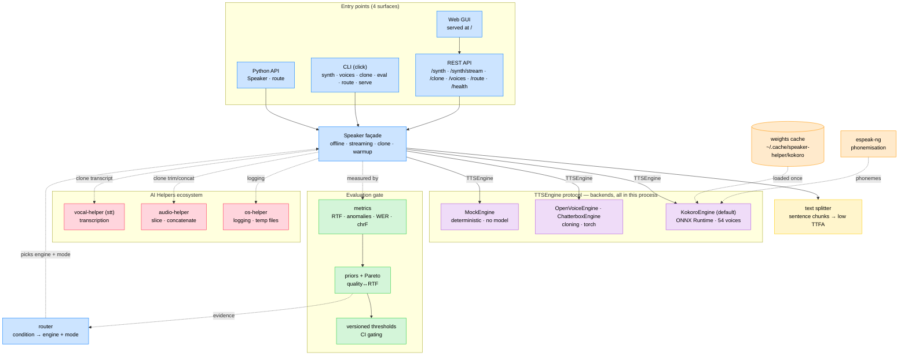
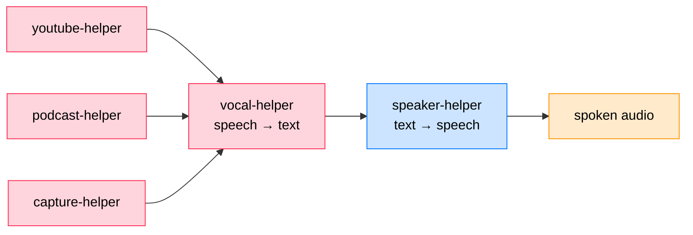

# Technical Stack — speaker-helper

How speaker-helper is put together, what each layer does, and where it sits in
the **AI Helpers** ecosystem.

---

## Architecture

---

## Layers

| Layer | Module | Responsibility |
|------|--------|----------------|
| Types | `types.py` | `Voice`, `AudioResult` (+`rtf`), `StreamChunk`, `VoiceList`, `VoiceSample` |
| Config | `config.py` | YAML + `${VAR}` + `SPEAKER_HELPER_*` overrides; `backend`, `clone`, `mock` |
| Engine | `engine.py` | `TTSEngine` protocol, backend registry, `MockEngine` |
| Backends | `backends/` | `kokoro.py` (default, ONNX in-process), `openvoice.py`, `chatterbox.py` |
| Install | `install.py` | fetches Kokoro's ~340 MB from a pinned release, size-checked |
| Façade | `speaker.py` | `Speaker` — `say` / `stream` / `clone_voice` / `warmup` / `from_profile` / `from_route` |
| Router | `router.py` | condition (`online_realtime` / `offline`) → engine + mode from measured quality↔speed evidence, minus the languages the owner has arbitrated himself (`OFFLINE_RATIFIED_ENGINE`, flagged `owner_ratified`) |
| Profiles | `profiles.py` | per-language hyperparameters (producer/consumer) + measured RTF/quality |
| Text | `text.py` | sentence splitting for low time-to-first-audio |
| CLI | `cli.py` | `synth`, `voices`, `clone`, `eval`, `speak-from`, `route`, `serve` — one click group over the shared `_cmd_*` handlers |
| API | `api.py` | FastAPI — offline, SSE streaming, cloning upload, `/route`, GUI at `/` |
| GUI | `gui/` | minimal vanilla-JS + Tailwind single page (synth / stream / voices / clone / route) |
| Cloning | `cloning.py` | clone defaults (ref-fr-female), trim + transcript preparation |
| Transcription | `transcription.py` | `vocal-helper` adapter (clone transcript + eval round-trip) |
| Sources | `sources.py` | speech-to-speech in: youtube / podcast / microphone → `revoice` |
| Evaluation | `eval/` | dataset, metrics, priors/Pareto, thresholds, runner, DeepEval metrics (incl. round-trip idempotence) |

---

## Design choices

- **Backend-agnostic core, and no second process.** Everything talks to the
  `TTSEngine` protocol, never to a concrete engine: `create_engine(settings)`
  looks `settings.backend` up in a module-level registry. Four backends are
  registered — `kokoro` (the default), `openvoice`, `chatterbox`, `mock` — and
  every one of them synthesises in the calling process. The package shipped a
  fifth once, a REST client for a desktop application on a fixed port; it was
  removed when the default moved in-process, because an engine you have to
  install, launch and keep alive is not a second option but a second way to
  fail. `register_backend` adds your own with one call.
- **Low time-to-first-audio.** Streaming splits text into sentence chunks and
  pipelines synthesis (`stream_concurrency=1` by default) so the first chunk is
  emitted as early as possible while later chunks are produced ahead of playback.
- **Evaluation, not vibe checks.** A committed dataset + versioned thresholds
  gate speed (RTF), signal integrity (anomalies), and — with a transcriber —
  fidelity (WER/chrF). The gate returns a non-zero exit code for CI. Quality is
  round-trip **intelligibility** (text→speech→text); naturalness (MOS) and
  speaker-similarity are measured in the companion study and fed back as data.
- **Routing, justified by measurement.** The evaluation layer measures; the
  `router` acts. A **condition** — `online_realtime` (speed = RTF, must beat real
  time; maximise quality on the Pareto front among engines that keep up) or
  `offline` (quality only) — maps to a concrete engine + mode, with provenance
  (`quality_source`), a `confidence` flag, and a number-citing justification.
- **Nothing fetched at synthesis time.** The default engine's weights come from
  a pinned `kokoro-onnx` GitHub release and then live in
  `~/.cache/speaker-helper/kokoro`; `install.py` checks the exact byte sizes so
  a truncated download is repaired rather than mistaken for an install. Copy
  that directory and the engine runs air-gapped. Only the cloning backends
  still fetch their own checkpoints.
- **Cloning made trivial.** Supply a recording; the transcript is derived with
  `vocal-helper` and over-long audio is trimmed with `audio-helper`, so a custom
  voice works from the library, CLI, and REST API alike.
- **Ecosystem-native.** Logging goes through `os-helper`; audio slicing and
  concatenation through `audio-helper` — the same building blocks as the other
  `*-helper` projects.

---

## Ecosystem

speaker-helper is the **text → speech** node of the AI Helpers graph, the
inverse of `vocal-helper` (speech → text). Since v0.4.0 it also closes the
**speech-to-speech** loop: `speaker_helper.sources` pulls audio from
`youtube-helper`, `podcast-helper`, or `capture-helper` (live microphone),
transcribes it with `vocal-helper`, and re-voices it.

---

Author: Warith HARCHAOUI — https://harchaoui.org/warith/ai-helpers
